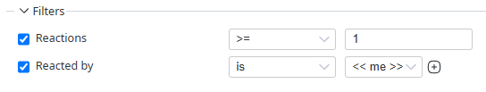

# Redmine Issue Reaction Query

A Redmine plugin that makes issue reactions (introduced in Redmine 6.1) usable in the issue list. It adds a sortable column and two filters, controlled by a role permission.

Only reactions on the issue itself are counted. Reactions on notes (journals) are not included.

## Features

- **Column: "Reactions"**
  - Shows the number of reactions on each issue.
  - Sortable by clicking the column header.
  - Can be used in the sort criteria of saved queries.
- **Filter: "Reactions"** (count)
  - Operators: `is`, `>=`, `<=`, `between`, `any`, `none`.
- **Filter: "Reacted by"**
  - Lets you list issues you have (or have not) reacted to.
  - Only `<< me >>` is offered. See "Design notes" below.
  - Shown only to logged-in users.

## Requirements

- Redmine 6.1.0 or later

## Installation

1. Copy (or clone) this plugin into `plugins/redmine_issue_reaction_query` inside your Redmine installation.  The directory name must be `redmine_issue_reaction_query`.

2. Restart Redmine. (No database migration is required.)

3. Check that the plugin appears under **Administration > Plugins**.

4. Grant the permission to the roles that should use the column and filters (see "Permissions").

## Uninstallation

Remove the plugin directory and restart Redmine. No data is stored by the plugin.

## Permissions

The plugin defines one permission, **"Use reaction column and filters"** (`use_reaction_query`), in the **Issue tracking** module.

- It is **not granted to any role by default**. Until you enable it under **Administration > Roles and permissions**, only administrators see the column and the filters.
- The single permission controls the column and both filters.
- The check is global: the column and filters are available if the user has the permission in at least one project. It is not evaluated per project for each issue.

## Usage

- Open the issue list, then add **Reactions** to the columns in the Options section. Click the column header to sort.
- Add the **Reactions** or **Reacted by** filter in the Filters section.
- Save the query to keep the columns, filters, and sort order.

## Notes and limitations

- The column and filters are not shown when reactions are disabled in the administration settings, or when the user lacks the permission.
- The reaction count is a plain count of all reactions on the issue. It is not restricted by `Reaction.visible`, so it may **differ from the count shown on the issue page if some reacting users are not visible to the current user**.
- Sorting and filtering use a SQL subquery on the `reactions` table. Check performance on very large installations.
- Behavior of a saved query that contains these filters when opened by a user without the permission has not been verified.

## Design notes

- **Why is the patch applied in an `after_plugins_loaded` hook?**
  Some plugins patch `IssueQuery` with `alias_method` chains from their own `after_plugins_loaded` hook. Prepending earlier, from `init.rb`, would make their alias capture this plugin's method and recurse infinitely. Hook listeners run in registration order and plugins load alphabetically, so this plugin's patch is applied after theirs.

- **Why only `<< me >>` in "Reacted by"?**
  Letting users pick other users would allow searching for who reacted to what, bypassing the visibility rules of reactions. The filter therefore always uses the current user, regardless of the submitted value.

## Known limitation

A plugin whose name sorts after `redmine_issue_reaction_query` and that patches `IssueQuery` with `alias_method` from its own `after_plugins_loaded` hook can still conflict.

## Compatibility

Tested on Redmine 6.1 (column and filters). Not tested on 7.x.

## License

GNU General Public License v2.0 (GPL-2.0). See [LICENSE](LICENSE).